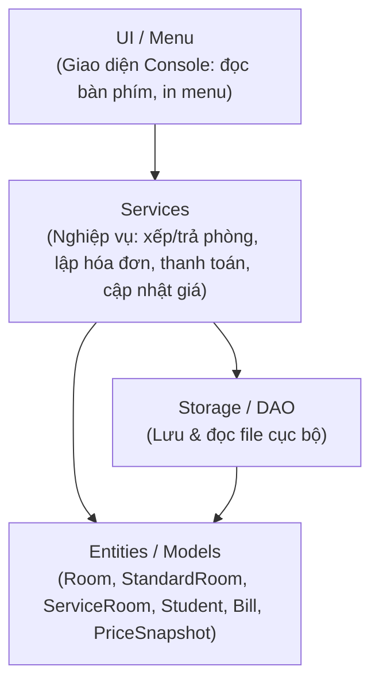

# FPTU-FA26-PRO192-SE21B-Group1
## 📖 1. Giới thiệu dự án

**Dorm Utility Management System** là ứng dụng **Java console** hỗ trợ ban quản lý một khu ký túc xá nhỏ theo dõi sinh viên đang ở trong từng phòng và số tiền phải thu hằng tháng. Dự án được thực hiện trong khuôn khổ môn **PRO192 – lớp SE21B (FA26)**.

### 🎯 Mục tiêu

- Quản lý **phòng**, **sinh viên** và việc **xếp / trả phòng** (kiểm tra trùng chỗ ở và sức chứa).
- Nhập chỉ số điện, nước đầu/cuối của từng phòng theo tháng để **lập hóa đơn**.
- **Xác nhận thanh toán**, tra cứu hóa đơn, liệt kê hóa đơn còn nợ và tính tổng nợ.
- **Lưu / đọc lại** toàn bộ dữ liệu (phòng, sinh viên, phân phòng, giá hiện hành, hóa đơn) khi khởi động lại chương trình.

### ⚙️ Chức năng chính

| # | Chức năng |
|---|-----------|
| 1 | Thêm / xem danh sách phòng (phòng thường & phòng dịch vụ), tìm phòng theo mã |
| 2 | Thêm sinh viên, tìm theo MSSV; xếp sinh viên vào phòng hoặc xác nhận trả phòng |
| 3 | Hiển thị sức chứa, số người đang ở và số chỗ trống của mỗi phòng |
| 4 | Nhập chỉ số điện/nước đầu – cuối của một phòng trong một tháng và lập hóa đơn |
| 5 | Xem chi tiết hóa đơn: tiền phòng, phí dịch vụ (nếu có), tiền điện, tiền nước, tổng tiền, trạng thái |
| 6 | Xác nhận thanh toán toàn bộ một hóa đơn; liệt kê hóa đơn còn nợ và cộng tổng nợ |
| 7 | Cập nhật giá hiện hành của phòng / điện / nước (chỉ áp dụng cho hóa đơn lập **sau đó**) |
| 8 | Lưu và đọc lại dữ liệu từ file cục bộ khi khởi động lại |

### 💰 Giá mẫu & công thức tính tiền

> Các giá dưới đây chỉ phục vụ bài tập, không đại diện cho chính sách ký túc xá thực tế. Đơn vị tiền: **đồng**.

| Khoản | Giá mẫu |
|-------|---------|
| Phòng thường | 1.200.000 đ/tháng, không thu phí dịch vụ |
| Phòng dịch vụ | 1.800.000 đ/tháng + phí dịch vụ 300.000 đ/tháng |
| Điện | 3.000 đ/kWh |
| Nước | 15.000 đ/m³ |

```text
Điện tiêu thụ = chỉ số điện cuối − chỉ số điện đầu
Nước tiêu thụ = chỉ số nước cuối − chỉ số nước đầu
Tổng hóa đơn  = tiền phòng + phí dịch vụ + tiền điện + tiền nước
```

Mọi khoản tiền được tính **theo phòng**, không nhân với số người ở và không chia cho từng sinh viên. Tiền và chỉ số là số nguyên không âm, tính toán bằng kiểu `long`.

### 📏 Quy tắc nghiệp vụ & ràng buộc quan trọng

- Mỗi sinh viên chỉ ở **tối đa một phòng**; không xếp thêm khi phòng đã đủ sức chứa (1–10 người/phòng).
- Chỉ xếp/trả phòng và lập hóa đơn với các mã **đã tồn tại**; chỉ lập hóa đơn cho phòng **đang có người ở**.
- Mỗi cặp **mã phòng – tháng (`YYYY-MM`)** chỉ có **một** hóa đơn, dù đang nợ hay đã trả.
- Mã phòng, MSSV, mã hóa đơn: không rỗng, không chứa khoảng trắng, duy nhất và không đổi sau khi tạo.
- Chỉ số điện/nước từ 0 đến 1.000.000; chỉ số cuối phải **≥** chỉ số đầu (cho phép bằng nhau).
- Thanh toán là trả đủ một lần; xác nhận lại hóa đơn đã trả phải báo rõ và không thu thêm tiền.
- Hóa đơn đã lập **không sửa / xóa**; trả phòng không làm mất hóa đơn hoặc khoản nợ cũ.
- Thao tác bị từ chối **không được làm thay đổi** một phần dữ liệu hợp lệ đã có.

### 🌟 Điểm nhấn kỹ thuật

- **Kế thừa (Inheritance) & Đa hình (Polymorphism):** Sử dụng lớp trừu tượng `Room` và hai lớp con `StandardRoom` (Phòng thường), `ServiceRoom` (Phòng dịch vụ) để tính tiền phòng thông qua lời gọi đa hình `calculateRoomCharge()`.
- **Bảo toàn lịch sử dữ liệu (Price Snapshot):** Mỗi hóa đơn (`Bill`) lưu giữ một bản chụp đơn giá tại thời điểm lập, đảm bảo việc cập nhật bảng giá mới không làm sai lệch các hóa đơn trong quá khứ.
- **Đóng gói chặt chẽ:** Mọi thuộc tính đều `private`; không trả danh sách nội bộ ra ngoài để tránh vượt sức chứa.
- **Tách biệt nghiệp vụ và giao diện:** Logic tính toán/kiểm tra độc lập với việc đọc bàn phím, in menu nên có thể kiểm thử trực tiếp.

### 🛠️ Môi trường

- Ngôn ngữ: **Java console**, **JDK 1.8 (JDK 8)**
- IDE: **NetBeans 17**
- Thư viện: chỉ dùng Java SE chuẩn (không framework)
- Lưu trữ: file cục bộ (không dùng cơ sở dữ liệu)

### 🚫 Ngoài phạm vi

GUI, web, cơ sở dữ liệu, đăng nhập, thanh toán trực tuyến, gửi thông báo, hợp đồng, tiền cọc, chuyển phòng tự động, chia tiền theo từng người, giá điện nước lũy tiến, tính theo ngày ở.

---

## 👥 2. Thành viên nhóm & Phân công (Team Members)

| STT | MSSV | Họ và tên | Vai trò & Phần việc phụ trách | Ca kiểm thử (Test Cases) |
|:---:|:----:|-----------|-------------------------------|:------------------------:|
| 1 | `QS190001` | Thái Quang Huy | Hai loại phòng, tính tiền đa hình, cập nhật giá hiện hành | K01, K02, K03 |
| 2 | `QE200043` | Lê Thành Luân | Hồ sơ sinh viên, xếp/trả phòng, kiểm tra trùng chỗ & sức chứa | K04, K05 |
| 3 | `QE210067` | Hồ Trương Anh Quân | Nhập chỉ số/tháng, lập hóa đơn và bản chụp giá (Snapshot) | K02, K03, K06, K07, K11 |
| 4 | `QE210182` | Nguyễn Đăng Huy | Thanh toán, tra cứu hóa đơn, danh sách và tính tổng nợ | K08, K09 |
| 5 | `QE210233` | Lê Trần Khải Nguyên | Lưu/đọc file, nối dữ liệu sau khi đọc, truy vấn chi tiết | K09, K10 |

---

## 🏗️ 3. Kiến trúc & Thiết kế Hướng đối tượng (OOP Architecture & Entities)

Hệ thống được thiết kế theo nguyên lý tách biệt trách nhiệm (Separation of Concerns), chia thành 4 tầng rõ rệt: **Entities** (Mô hình dữ liệu), **Services** (Xử lý nghiệp vụ), **Storage/DAO** (Đọc/Ghi file) và **UI/Menu** (Giao diện Console). Mọi thuộc tính trong các lớp đều được đóng gói (`private`) và truy cập tường minh qua `this.` và `super.`.



### 3.1. Các Thực thể chính (Core Entities / Models)

| Lớp | Vai trò | Dữ liệu chính |
|-----|---------|---------------|
| `Room` *(abstract)* | Lớp cha trừu tượng của mọi loại phòng; quản lý danh sách mã sinh viên đang ở | Mã phòng, sức chứa, tiền phòng hiện hành, danh sách mã SV đang ở; phương thức trừu tượng `calculateRoomCharge()` |
| `StandardRoom` | Phòng thường | Kế thừa `Room`; `calculateRoomCharge()` trả về tiền phòng, không có phí dịch vụ |
| `ServiceRoom` | Phòng dịch vụ | Kế thừa `Room`, thêm phí dịch vụ; `calculateRoomCharge()` trả về tiền phòng + phí dịch vụ |
| `Student` | Hồ sơ sinh viên | MSSV, họ tên, mã phòng đang ở (hoặc chưa được xếp phòng) |
| `Bill` | Hóa đơn của một phòng trong một tháng | Mã hóa đơn, mã phòng, tháng `YYYY-MM`, chỉ số điện/nước đầu–cuối, `PriceSnapshot`, trạng thái nợ/đã trả |
| `PriceSnapshot` | Bản chụp giá tại thời điểm lập hóa đơn | Loại phòng, tiền phòng, phí dịch vụ, đơn giá điện, đơn giá nước |

> 📝 *Tên lớp ở trên theo gợi ý của đề bài; nếu tên thực tế trong source code khác, hãy chỉnh lại cho khớp.*

### 3.2. Quan hệ & các điểm thiết kế quan trọng

- **Kế thừa & Đa hình:** `Room` định nghĩa `calculateRoomCharge()` là phương thức trừu tượng; `StandardRoom` và `ServiceRoom` override để trả về tiền phòng thường hoặc tiền phòng cộng phí dịch vụ. Khi lập hóa đơn, service gọi phương thức này **qua tham chiếu `Room`**, không dùng chuỗi `if` theo tên loại phòng. Một `List<Room>` chứa cả hai loại phòng vẫn được xử lý bằng một vòng lặp gọi phương thức chung.
- **`Room` quản lý người ở:** `Room` giữ danh sách mã sinh viên đang ở. Service xếp phòng kiểm tra đồng thời **sức chứa** của phòng và **chỗ ở hiện tại** của sinh viên (mỗi SV chỉ ở một phòng). `Room` không trả danh sách nội bộ ra ngoài mà chỉ cung cấp các thao tác kiểm tra/thêm/bớt phù hợp, tránh việc mã bên ngoài tự thêm người vượt sức chứa.
- **`Bill` sở hữu `PriceSnapshot`:** Hóa đơn lưu bản chụp giá và chỉ số của chính nó, nên khi cập nhật giá hiện hành hoặc tra cứu phòng, **hóa đơn cũ không bị tính lại**. Đây là quan hệ *composition*: bản chụp giá chỉ tồn tại cùng hóa đơn.
- **Tách nghiệp vụ khỏi giao diện:** Việc tính tiền và kiểm tra nghiệp vụ nằm ở tầng Service/Entity, còn đọc bàn phím và in menu nằm ở tầng UI nên có thể kiểm thử trực tiếp bằng console hoặc Java test driver.
- **Toàn vẹn dữ liệu:** Mọi điều kiện được kiểm tra **trước** khi cập nhật các đối tượng liên quan; thao tác bị từ chối không để lại thay đổi một phần.
- **Lưu trữ:** Tầng Storage/DAO ghi và đọc lại phòng (kèm loại phòng), sinh viên, phân phòng, giá hiện hành và toàn bộ hóa đơn; sau khi đọc, dữ liệu phòng – sinh viên – hóa đơn được nối lại quan hệ. Mã hóa đơn mới không được trùng với mã đã lưu.

---

## 🧪 4. Các test case (Test Cases)

### 4.1. Bộ dữ liệu khởi đầu

| Mã | Loại / Họ tên | Sức chứa / Phòng hiện tại |
|----|---------------|---------------------------|
| A101 | Phòng thường, giá mẫu | 2 chỗ |
| A102 | Phòng dịch vụ, giá mẫu | 3 chỗ |
| QE210001 | Nguyễn An | A101 |
| QE210002 | Trần Bình | A101 |
| QE210003 | Lê Chi | A102 |
| QE210004 | Phạm Dũng | Chưa xếp |

Mỗi ca bắt đầu từ bộ dữ liệu trên và giá mẫu, trừ khi ca mô tả một chuỗi thao tác liên tiếp.

### 4.2. Các ca nghiệm thu bắt buộc (K01 – K11)

| Mã ca | Người thực hiện | Thao tác / đầu vào | Kết quả mong đợi |
|:-----:|-----------------|--------------------|------------------|
| **K01** | Thái Quang Huy | Qua `Room`, tính tiền phòng cho A101 và A102 | Lần lượt **1.200.000** và **2.100.000**; chạy hai phương thức override thực sự |
| **K02** | Thái Quang Huy, Hồ Trương Anh Quân | Lập A101/2026-10: điện 100→150, nước 20→30 | Điện **150.000**, nước **150.000**, tổng **1.500.000**, trạng thái nợ |
| **K03** | Thái Quang Huy, Hồ Trương Anh Quân | Lập A102/2026-10: điện 100→150, nước 20→30 | Tổng **2.400.000**; không nhân với số người hoặc sức chứa |
| **K04** | Lê Thành Luân | Xếp QE210004 vào A101; sau đó thử xếp QE210001 vào A102 | Cả hai bị từ chối; A101 vẫn 2 người, A102 vẫn 1 người |
| **K05** | Lê Thành Luân | QE210002 trả A101, sau đó xếp QE210004 vào A101 | A101 còn đúng 2 người: QE210001, QE210004; QE210002 chưa có phòng |
| **K06** | Hồ Trương Anh Quân | Lập A101 với điện 150→100 hoặc nước đầu −1; thử tháng 2026-13 | Từng đầu vào bị từ chối; số hóa đơn không tăng |
| **K07** | Hồ Trương Anh Quân | Lập hai lần cùng A101/2026-10 như K02 | Chỉ có 1 hóa đơn, tổng nợ **1.500.000**, không tạo bản sao |
| **K08** | Nguyễn Đăng Huy | Tạo K02 và K03 rồi thanh toán hóa đơn A101; xác nhận trả lần nữa | Tổng nợ ban đầu **3.900.000**, sau trả còn nợ **2.400.000**; lần xác nhận lại không đổi tiền |
| **K09** | Nguyễn Đăng Huy, Lê Trần Khải Nguyên | Tạo K02; đổi giá điện thành 4.000; lập A101/2026-11 với cùng chỉ số | Hóa đơn tháng 10 vẫn **1.500.000**; tháng 11 là **1.550.000** |
| **K10** | Lê Trần Khải Nguyên | Tạo K02/K03, thanh toán hóa đơn A101, lưu, thoát hẳn rồi mở lại; lập hóa đơn hợp lệ cho tháng mới | Khôi phục đủ 2 loại phòng, 4 SV, phân phòng; trước khi lập thêm, A101 đã trả **1.500.000**, A102 nợ **2.400.000**; mã hóa đơn mới không trùng mã đã lưu |
| **K11** | Hồ Trương Anh Quân | Lập A101/2026-10 với điện 100→100 và nước 20→20 | Điện/nước bằng **0**, tổng **1.200.000**; chấp nhận chỉ số đầu bằng cuối |
